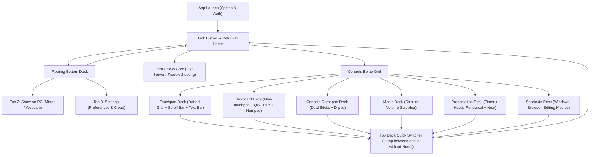

# Competitive UI Analysis & Redesign Plan: "PC Remote Pro" vs. "Remote Mouse & Gamepad Pro"

## 1. Executive Summary

Based on the detailed screen-recording analysis of the reference competitor application (**"PC Remote Pro"** on Android 16 / Motorola Edge 50 Pro), this document defines an end-to-end UI/UX overhaul for **Remote Mouse & Gamepad Pro**.

The competitor's primary strength lies in its **Hub-and-Spoke Dashboard Architecture**:
- Rather than immediately dropping the user into an active touchpad with crowded tabs, it greets the user with an inviting **Central Home Dashboard** with clear card categories (**Controls**, **Show on PC**, and **Your PCs**).
- High-contrast **dark obsidian bento-card aesthetic** with glowing **cyber teal / mint** accent pills.
- Dedicated, purpose-built control decks:
  1. **Touchpad Deck**: Dotted-matrix canvas, subtle in-canvas gesture guides, bottom click zone with center scroll slider, and a docked text-input bar.
  2. **Keyboard Deck**: Upper mini-touchpad (type and aim simultaneously) + full PC mechanical keycaps.
  3. **Presentation Remote Deck**: Slide rehearsal timer with tactile warnings (5m and 1m remaining), slide controls (F5, B, W, Esc), and huge Next/Back thumb pads.
  4. **Shortcuts & Macros Deck**: One-tap OS action grid (Windows management, Browser shortcuts, Editing commands, System tools).
- **Floating Bottom Dock**: Minimalist 3-tab floating navigation pill (`Remote`, `Show on PC`, `Settings`).

---

## 2. Key Screen Breakdown & Visual Evidence

All screenshots have been extracted at high resolution from `screen-20261123-143435.mp4` and preserved in [`docs/competitive_analysis/`](file:///d:/Partition1%20Backup/PROJECTS/Self/Remote%20Mouse%20App/remote_mouse_app/docs/competitive_analysis).

### Screen 1: Central Home Dashboard ("Remote" Hub)


#### Architectural Strengths:
1. **Hero Connection Status Banner**:
   - Large rounded card at the top with a subtle matrix texture.
   - Displays real-time connection state (`● Starting • Bluetooth`, `● Connected`, or `● Not Supported`).
   - Contextual troubleshooting actions directly in the banner (`Try again`, `Frequently asked`).
2. **Bento-Grid Controls Section**:
   - **Touchpad**: Wide hero card with an animated glowing trajectory curve and subtitle `Swipe • two fingers • pinch`.
   - **Keyboard**: Icon + `PC keys • numpad • typing`.
   - **Media**: Icon + `Playback • volume`.
   - **Presentation**: Icon + `Timer • notes`.
   - **Shortcuts**: Icon + `By OS • macros`.
3. **"Show on PC" Section**:
   - Secondary card row introducing browser-based Screen Mirroring and Webcam streaming.
4. **"Your PCs" Section**:
   - Shows active/saved host PCs with quick pairing and connection troubleshooting.
5. **Floating Bottom Navigation Dock**:
   - Elevated pill dock with active tab highlighted by a rounded teal capsule (`Remote`, `Show on PC`, `Settings`).

---

### Screen 2: Modern Touchpad Deck


#### Architectural Strengths:
1. **Dotted Matrix Canvas**:
   - Subtle dot-grid surface that gives the user a high-tech digitizer feel.
2. **In-Canvas Gesture Guide**:
   - Minimalist, centered typography explaining gesture combinations:
     - `Slide: move the pointer`
     - `Tap: click / two fingers: right click`
     - `Two fingers: scroll / pinch: zoom`
     - `Tap, then hold and slide: drag`
3. **Top Sub-Navbar**:
   - Compact icon-based quick switcher allowing 1-tap switching between Touchpad, Keyboard, Media, Gamepad, Presentation, and Shortcuts without going back to Home.
4. **Bottom Mouse & Scroll Controls**:
   - Rounded pill buttons for `Left` and `Right` clicks with a dedicated vertical scroll slider (`↕`) between them.
5. **Docked Text Input Bar**:
   - Permanent bottom input field: `Type here to send to the PC` + `Send` button. Eliminates opening/closing the soft keyboard just to type search queries or URLs!

---

### Screen 3: Dual-Mode Keyboard Deck


#### Architectural Strengths:
1. **Upper Mini-Touchpad**:
   - Includes a mini dotted trackpad with small Left/Right buttons above the keyboard.
   - Users can position the cursor or click text fields while typing without switching tabs!
2. **Segmented Sub-Modes**:
   - `Keyboard` (Full PC layout), `Numpad` (Dedicated numeric calculations), `Phone keyboard` (Native OS soft keyboard).
3. **PC Keyboard Layout**:
   - Full Function Row (`Esc`, `F1`–`F12`).
   - High-contrast keycaps with secondary symbols (`!`, `@`, `#`, `$`, `%`).
   - Sticky modifier keys (`Ctrl`, `Win`, `Alt` with "Tap twice to hold" locking).

---

### Screen 4: Presentation Remote Deck (New Feature)


#### Architectural Strengths:
1. **Slide Rehearsal Timer**:
   - Dual readout: `00:00 Elapsed` circular dial + `10:00 / 10:00 Left` countdown.
   - `Start` and `Reset` controls.
   - Tactile rehearsal alerts: Vibrates automatically when 5 minutes and 1 minute remain!
2. **Presentation Shortcuts Row**:
   - `Start (F5)`, `From here (Shift+F5)`, `Black screen (B)`, `White screen (W)`, `End (Esc)`.
3. **Massive Navigation Pads**:
   - Designed for blind thumb navigation during live speeches:
     - `‹ Back` (dark rounded button)
     - `› Next` (huge, prominent vibrant teal pad)

---

### Screen 5: Shortcuts & OS Macros Deck (New Feature)


#### Architectural Strengths:
1. **Task-Oriented Categorization**:
   - **Editing**: Copy (`Ctrl+C`), Paste (`Ctrl+V`), Cut (`Ctrl+X`), Undo (`Ctrl+Z`), Redo (`Ctrl+Y`), Select All (`Ctrl+A`), Save (`Ctrl+S`), Find (`Ctrl+F`).
   - **Windows Management**: Switch App (`Alt+Tab`), All Windows (`Win+Tab`), Desktop (`Win+D`), Close Window (`Alt+F4`), Minimize (`Win+↓`), Maximize (`Win+↑`), Snap Left (`Win+←`), Snap Right (`Win+→`), Next/Previous Desktop.
   - **Browser Navigation**: New Tab (`Ctrl+T`), Close Tab (`Ctrl+W`), Reopen Tab (`Ctrl+Shift+T`), Reload (`F5`), Address Bar (`Ctrl+L`), Zoom In/Out, Full Screen (`F11`).
   - **System Tools**: Search (`Win`), Lock PC (`Win+L`), Screenshot (`Shift+Win+S`), Task Manager (`Ctrl+Shift+Esc`).

---

### Screen 6: "Show on PC" & Screen Mirroring


#### Architectural Strengths:
- Clean card-based toggle between Screen Mirroring and Phone Camera as Webcam.
- Configurable stream resolution (`480p`, `720p`, `1080p`, `Full`) and frame rates (`15`, `20`, `30` FPS).

---

### Screen 7: Modern Settings & Theme Customizer


#### Architectural Strengths:
- Theme mode switch (`System` | `Light` | `Dark`).
- Interactive accent palette bubbles (Cyan, Emerald, Amber, Violet, Crimson).
- Troubleshooting wizard (`Check the connection`, `Steps to fix the connection`).

---

## 3. Comparison: Competitor vs. Remote Mouse Pro

| Feature / UI Element | Competitor (PC Remote Pro) | Remote Mouse Pro (Current) | Remote Mouse Pro (Planned Overhaul) |
|---|---|---|---|
| **App Architecture** | Hub-and-Spoke Home Dashboard | Direct Tab Interface (Trackpad first) | **Hub-and-Spoke Home Dashboard + Quick Decks** |
| **Color Theme** | Pitch Obsidian + Cyber Teal (`#14b8a6`) | Dark Blue-Grey (`#0b0c10` + `#3b82f6`) | **Obsidian Matrix + Cyber Teal Glow (`#14b8a6`)** |
| **Trackpad Texture** | Dotted Matrix Grid with guides | Monolithic Glass Surface | **Dotted Matrix Grid + Monolithic Glass Toggle** |
| **Direct Text Input** | Permanent bottom dock input | Modal text prompt | **Integrated Bottom Text Input Bar** |
| **Keyboard Deck** | Mini-Touchpad + Full PC Layout | Mechanical Keycap layout | **Mini-Touchpad + Mechanical Keycap layout** |
| **Presentation Deck** | Timer + Rehearsal Haptics + Big Next | None | **Full Presentation Remote Deck** |
| **Shortcuts Deck** | Categorized Macro Bento Grid | None | **Windows / Browser / Editing Macro Deck** |
| **Gamepad Deck** | None (Basic) | **Console-grade Analog + Clover D-Pad** | **Console Gamepad retained & featured on Home Hub** |
| **Motion Latency** | Bluetooth (prone to vendor limits) | **Ultra-Low Latency UDP (<1ms)** | **Ultra-Low Latency UDP + Multi-Adapter Wi-Fi** |
| **Navigation Style** | Floating Bottom Pill Dock | Top Tab Bar | **Floating Bottom Pill Dock + Deck Quick Switcher** |

---

## 4. UI Architecture & Navigation Design



---

## 5. Design System & Design Tokens

### 5.1 Color Palette
```typescript
export const CyberTokens = {
  // Backgrounds
  bgRoot: '#07080b',           // Pitch obsidian black
  bgCard: '#11141c',           // Elevated bento card
  bgCardHover: '#171b26',      // Card active/pressed state
  bgInput: '#0d0f17',          // Recessed text dock

  // Borders & Dividers
  borderSubtle: 'rgba(255, 255, 255, 0.07)',
  borderHighlight: 'rgba(20, 184, 166, 0.35)',
  borderDotted: '#1e2433',

  // Primary Cyber Teal Accent (from Competitor)
  accent: '#14b8a6',           // Vibrant Cyber Teal / Mint
  accentGlow: 'rgba(20, 184, 166, 0.35)',
  accentSoft: 'rgba(20, 184, 166, 0.16)',
  accentPill: '#0d9488',

  // Status Alerts
  statusActive: '#22c55e',      // Green dot
  statusWarning: '#f59e0b',     // Amber connection banner
  statusError: '#ef4444',       // Red disconnected

  // Typography
  textPrimary: '#f8fafc',       // High contrast title
  textSecondary: '#94a3b8',     // Subtitle & microcopy
  textMuted: '#64748b',         // Tertiary label
  textAccent: '#2dd4bf',        // Teal highlight text
};
```

### 5.2 Layout & Component Specifications
1. **Home Bento Cards**:
   - Border radius: `18px`.
   - Subtle inner border: `1px solid rgba(255, 255, 255, 0.08)`.
   - Padding: `14px 16px`.
   - Dynamic touch opacity with haptic tick.
2. **Floating Bottom Dock**:
   - Floating pill positioned `16px` above screen bottom.
   - Background: `rgba(18, 20, 28, 0.94)` with glass blur (`backdrop-filter: blur(20px)`).
   - Rounded border radius: `999px` (capsule).
   - Active tab highlighted by filled teal capsule with dark icon.
3. **Dotted Grid Trackpad Surface**:
   - Canvas pattern: Repeating radial dots (`1.5px` radius, `18px` spacing).
   - Minimalist centered typography with KaTeX-like clarity.
   - Vertical center scroll slider with friction haptics.
   - Docked bottom text field with `Send` button.

---

## 6. Implementation Roadmap & Phases

### Phase 1: Design Tokens & Hub Architecture Refactor
- Create `src/theme/cyberTokens.ts` matching the competitor's obsidian & teal palette.
- Refactor `App.tsx` from immediate deck view to the **Hub-and-Spoke Home Architecture**.
- Create `src/components/BottomDock.tsx` (floating capsule navigation).

### Phase 2: Central Home Hub (`HomeScreen.tsx`)
- Build Hero Connection Card with live server state and quick troubleshooting button.
- Build Bento Grid section for **Controls** (Touchpad, Keyboard, Gamepad, Media, Presentation, Shortcuts).
- Build **Show on PC** preview section.
- Build **Your PCs** host manager card.

### Phase 3: Touchpad Deck Modernization (`TrackpadScreen.tsx`)
- Add Dotted Matrix canvas background.
- Add centered gesture guide typography.
- Add vertical center scroll slider (`↕`) between Left and Right click buttons.
- Add docked quick text input bar (`Type here to send to PC` + `Send`).
- Add Top Deck Quick Switcher bar.

### Phase 4: Keyboard Deck with Mini-Touchpad (`KeyboardScreen.tsx`)
- Add upper Mini-Touchpad surface for simultaneous typing and cursor positioning.
- Add sub-tabs: `Keyboard` | `Numpad` | `Phone Keyboard`.
- Refine mechanical keycaps and sticky modifier lock behavior.

### Phase 5: New Decks (Presentation & Shortcuts)
- **`PresentationScreen.tsx`**:
  - Slide timer with rehearsal vibration alerts (5m and 1m).
  - Shortcut bar (F5, Shift+F5, Black, White, Esc).
  - Giant `‹ Back` and `› Next` thumb pads.
- **`ShortcutsScreen.tsx`**:
  - Bento macro grid grouped into Editing, Windows, Browser, and System.

### Phase 6: Settings & Appearance Overhaul (`SettingsScreen.tsx`)
- Restructure Settings modal into a full screen tab accessible from the bottom dock.
- Add Theme switch (System / Light / Dark) and Cyber Teal color swatches.
- Add Connection troubleshooter step-by-step checklist.

### Phase 7: Verification & Build
- TypeScript typecheck (`tsc --noEmit`).
- Verify backward compatibility with the Python Gevent/UDP server.
- Build Android release APK with Gradle.
- Update `CHANGELOG.md` and document all changes.

