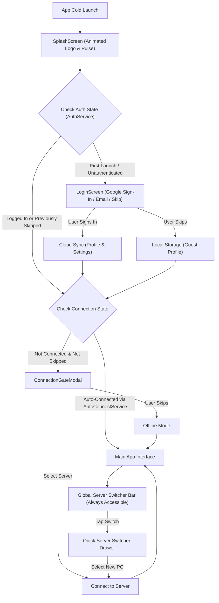

# Feature Implementation Plan: Loading Animation, Auth & Cloud Sync, and Connection Gating

## Overview
This document outlines the architecture, component design, data flow, and rollout plan for the requested feature suite in **Remote Mouse & Gamepad Pro**:
1. **Loading Screen Animation & Authentication Flow**:
   - Modern glassmorphic loading animation on startup.
   - Initial Login Screen supporting Google Authentication and auto-login methods.
   - Dual-mode data persistence (Cloud Sync for authenticated users vs. Local `AsyncStorage` for guest/offline).
   - "Skip" option enabling direct, friction-free access to the app interface.
2. **Server Connection Gating & Dedicated Server Switcher**:
   - Initial connection gate ensuring connection to a server unless skipped by the user.
   - Dedicated Server Switcher Navigation Bar accessible throughout the app.
   - Dynamic 1-tap host switching drawer to jump between PC servers on the fly.

---

## 1. Requirements & Acceptance Criteria

### Feature 1: Loading Screen & Authentication
| Requirement | Description | Acceptance Criteria |
|---|---|---|
| **R1.1: Loading Animation** | Visual splash screen displayed immediately on cold start. | Displays glowing animated logo, pulsing radar ring, version badge, and smooth fade-out (~1.2s–1.5s). |
| **R1.2: Login Screen** | First interactive screen seen after splash (if unauthenticated and unskipped). | Clean glassmorphic design matching existing UI with Google Sign-In, Email/Password, and Skip options. |
| **R1.3: Google Auto-Login** | Single-tap Google Sign-In using native Google credential manager. | Integrates Google Sign-In / Firebase Auth; retrieves email, display name, photo URL, and UID. |
| **R1.4: Skip Option** | Frictionless bypass option for users who don't want to log in. | "Skip & Continue as Guest ➔" button enters the app immediately without blocking features. |
| **R1.5: Cloud vs. Local Storage** | Synchronize user preferences (keybindings, sensitivity, themes, custom gamepad layouts). | **Logged-in**: Syncs profile & preferences to cloud. **Guest**: Persists locally via `AsyncStorage`. Seamless 1-tap cloud upgrade if signed in later. |
| **R1.6: Profile & Account Hub** | Access account status within the app. | Profile card in `SettingsModal` showing logged-in user details, cloud sync status, and Logout/Switch Account button. |

### Feature 2: Connection Gating & Dedicated Server Switcher
| Requirement | Description | Acceptance Criteria |
|---|---|---|
| **R2.1: Connection Gating** | On app entry, ensures connection before dumping user into disconnected controls. | If not connected, runs fast background discovery (<2s); if unconnected, displays an active Connection Gate modal with discovered servers and an explicit "Skip & Use Offline" button. |
| **R2.2: Dedicated Server Switcher Bar** | Persistent UI component indicating active connection and providing one-tap switching. | Compact navbar pill showing Server Name (or Disconnected), Latency badge (`4ms`), and an interactive `Switch ⇄` button. |
| **R2.3: Fast Server Switching Drawer** | Dynamic bottom sheet to switch between multiple host PCs. | Lists all LAN-discovered PCs with live signal strength, recent servers, quick rescan button, and single-tap server migration without leaving the active screen. |
| **R2.4: User Skip Independence** | Respects user's decision to bypass connection gating. | If skipped, the app remains in standalone offline mode without annoying repeated popups until the user taps the Switcher bar. |

---

## 2. Architecture & Component Hierarchy

### Component Breakdown
1. **`SplashScreen.tsx`**:
   - High-fidelity loading animation using `Animated` API (rotating neon gradient ring, glowing logo icon, subtle particle shimmer, and fading status text).
2. **`LoginScreen.tsx`**:
   - Modern obsidian glassmorphic card with Google One-Tap button, email/password collapsible form, terms link, and prominent "Continue as Guest / Skip" button.
3. **`AuthService.ts`**:
   - Manages authentication state (`currentUser`, `isGuest`, `authLoading`).
   - Persists session tokens in `AsyncStorage`.
   - Handles Google Sign-In integration and cloud data synchronization.
4. **`UserStorageService.ts`**:
   - Unified storage layer: reads/writes settings, custom gamepad mappings, sensitivity presets, and recent servers to either Cloud or Local `AsyncStorage`.
5. **`ConnectionGateModal.tsx`**:
   - Dedicated initial connection assurance screen. Animated Wi-Fi radar with live discovered hosts list, connect button, and "Skip to Offline Mode" button.
6. **`ServerSwitcherBar.tsx`**:
   - Compact status and navigation header bar placed directly under the top app bar or floating above controls. Shows live connection state, current server, ping latency, and `Change Server ⇄` trigger.
7. **`ServerSwitcherDrawer.tsx`**:
   - Quick bottom-sheet drawer for instant 1-tap switching between multiple discovered host PCs without navigating away from the Trackpad or Gamepad.

---

## 3. Implementation Steps & Roadmap

### Phase 1: Loading Screen & Animation Engine
1. **Create `SplashScreen.tsx`**:
   - Build stylized animation: breathing radar logo, animated orbital particle ring, and version badge.
   - Implement smooth transition lifecycle (`onAnimationComplete`) to unmount or crossfade into the next screen.
2. **Wire Startup Pipeline in `App.tsx`**:
   - Show `SplashScreen` on initial mount while parallel loading preferences, auth session, and last server cache.

### Phase 2: Authentication Screen & Cloud/Local Storage Engine
3. **Build `AuthService.ts` & `authConfig.ts`**:
   - Zero-Credential Offline-First Architecture:
     - `authConfig.ts` provides a clean placeholder for `GOOGLE_WEB_CLIENT_ID`.
     - When unconfigured (no Google Cloud Project or client ID yet), `AuthService` gracefully offers a simulated/dev Google Sign-In profile alongside the "Skip / Guest" mode, enabling immediate end-to-end testing of profile data and preference storage without build errors or runtime crashes.
     - Once you create a Google Cloud Project, simply pasting your Web Client ID into `authConfig.ts` instantly activates native Google Play Services authentication.
   - User identity schema: `uid`, `email`, `displayName`, `photoURL`, `isAnonymous`, `lastLogin`.
   - Methods: `loginWithGoogle()`, `loginAsGuest()`, `logout()`, `isSkipped()`.
4. **Create `LoginScreen.tsx`**:
   - Modern glassmorphic aesthetic matching app theme palette.
   - Auto-login Google button with official branding.
   - Prominent "Skip & Continue to App" button with tooltip ("Login enables cloud backup for your gamepad and trackpad configurations").
5. **Implement `UserStorageService.ts`**:
   - Synchronize custom gamepad button mappings, haptic intensity, sensitivity presets, and favorite host list.
   - Automatic sync-down on login; automatic sync-up on setting change.
   - Local fallback via `@react-native-async-storage/async-storage` for guest mode.
6. **Update `SettingsModal.tsx`**:
   - Add User Profile card with avatar, email, cloud sync indicator, and Sign In / Sign Out actions.

### Phase 3: Server Connection Gating & Switcher Navigation Bar
7. **Create `ConnectionGateModal.tsx`**:
   - Non-intrusive gating dialog shown on launch if disconnected:
     - Radar scanning indicator.
     - Live discovered PCs list with one-tap connect.
     - Secondary "Skip & Use Offline" button.
8. **Create `ServerSwitcherBar.tsx`**:
   - Sleek sub-header component or floating pill:
     - Active server name (e.g. `🖥️ PC-SHUBHAM`) or `🔴 Disconnected`.
     - Real-time latency badge (`3ms`).
     - Interactive `Switch ⇄` button.
9. **Create `ServerSwitcherDrawer.tsx`**:
   - Bottom sheet drawer displaying:
     - Discovered PC list on LAN.
     - Recent servers history.
     - Instant one-tap switch button.
     - Disconnect & Rescan controls.
10. **Refactor `App.tsx`**:
    - Integrate `ServerSwitcherBar` into the app layout.
    - Mount `ServerSwitcherDrawer` globally for instant access across Trackpad, Gamepad, Keyboard, and Media decks.

---

## 4. Technical Stack & Dependencies

| Dependency | Purpose | Implementation Notes |
|---|---|---|
| `@react-native-google-signin/google-signin` | Native Google Sign-In on Android | Clean native dialog; requires web client ID in app config. |
| `@react-native-async-storage/async-storage` | Local offline user & session cache | Already installed and configured in project. |
| Firebase / Supabase (or Lightweight Cloud Sync API) | Cloud user database & preference sync | Stores user profile, custom gamepad bindings, sensitivity presets. |
| React Native Animated & Easing | Splash animation & Switcher drawer | Native-driver animations for 60fps smooth glass transitions. |

---

## 5. Verification & Quality Assurance Strategy

1. **Splash Screen Verification**:
   - Cold start app: Ensure splash renders smoothly without white flash, runs for ~1.2s, and transitions cleanly.
2. **Auth & Skip Verification**:
   - Test "Skip": User taps skip $\rightarrow$ immediately enters Trackpad without friction. Restarting app remembers skip state or presents quick resume.
   - Test Google Sign-In: Authenticates, pulls profile picture/name, and displays in Settings.
   - Test Offline Guest Storage: Custom gamepad mappings and settings persist across restarts.
3. **Connection Gating Verification**:
   - Launch app with server offline: Gating radar appears, user taps "Skip" $\rightarrow$ controls operate in offline test mode.
   - Launch app with server online: Automatically pairs in <1s without blocking the user.
4. **Server Switcher Verification**:
   - Connect to Server A $\rightarrow$ Tap "Switch Server ⇄" $\rightarrow$ Select Server B $\rightarrow$ Verifies seamless migration without restarting app or dropping touch slop configs.

