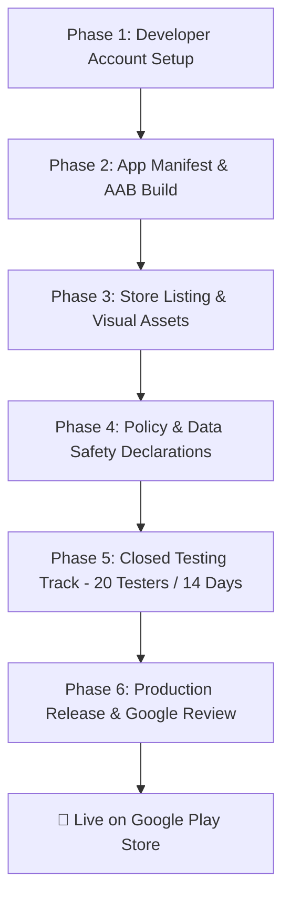

# 🚀 Google Play Store Publication Guide & Roadmap
### End-to-End Checklist, Technical Build Steps, and Policy Compliance for Remote Trackpad Pro

This document provides the complete roadmap and step-by-step instructions to publish **Remote Trackpad Pro** on the **Google Play Console** ([play.google.com/console](https://play.google.com/console)) so anyone can install it from the Play Store.

---

## 📋 Executive Checklist

- [ ] **Google Play Developer Account**: Registered ($25 USD) and identity-verified.
- [ ] **Manifest Clean-Up**: Removed unused permissions (e.g. `CAMERA`).
- [ ] **Upload Keystore**: Generated and configured in `gradle.properties`.
- [ ] **AAB Production Bundle**: Compiled via `.\gradlew.bat bundleRelease`.
- [ ] **Store Graphics Ready**: App Icon (512×512), Feature Graphic (1024×500), and 4–8 phone screenshots from `assets/`.
- [ ] **Privacy Policy Hosted**: Public URL pointing to `PRIVACY_POLICY.md`.
- [ ] **Data Safety Form**: Completed declaring zero data collection (100% offline local app).
- [ ] **App Access Reviewer Notes**: Written instructions explaining that the app pairs with a free PC companion server.
- [ ] **Closed Testing Track (20 Testers / 14 Days)**: Completed if using a personal account.
- [ ] **Production Release**: Submitted and approved.

---

## 🗺️ Phase-by-Phase Publishing Roadmap



---

## 🛠️ Phase 1: Google Play Console Account Setup

1. **Register**: Go to [Google Play Console](https://play.google.com/console/signup) and sign in with your Google account.
2. **Registration Fee**: Pay the one-time $25 USD developer fee.
3. **Identity Verification**:
   - Provide your legal name, physical address, and phone number.
   - Upload government ID (Passport, National ID, or Driver's License).
4. **Account Type Note**:
   - **Personal Account**: Requires a mandatory **Closed Testing phase with 20 testers for 14 continuous days** before production release.
   - **Organization Account**: Requires a D-U-N-S number, but does not require the 20-tester closed testing period.

---

## ⚙️ Phase 2: Technical Preparation & AAB Build

Google Play **requires** an **Android App Bundle (`.aab`)** for all new apps. Standard `.apk` uploads are rejected for initial production releases.

### 1. Remove Unused Camera Permission
In `mobile/android/app/src/main/AndroidManifest.xml`, ensure unused sensitive permissions are removed:
```xml
<!-- Remove CAMERA if not used for hardware camera capture -->
<!-- <uses-permission android:name="android.permission.CAMERA" /> -->
```
Active permissions needed:
- `android.permission.INTERNET` (Local socket communication)
- `android.permission.ACCESS_NETWORK_STATE` (Detect Wi-Fi connectivity)
- `android.permission.ACCESS_WIFI_STATE` (Wi-Fi subnet detection)
- `android.permission.CHANGE_WIFI_MULTICAST_STATE` (UDP discovery beacon)
- `android.permission.VIBRATE` (Tactile haptics)
- `android.permission.WAKE_LOCK` (Keep-awake toggle)

### 2. Generate a Production Upload Keystore
Open PowerShell and run:
```powershell
cd "d:\PROJECTS\Remote Mouse App\remote_mouse_app\mobile\android\app"
keytool -genkeypair -v -storetype PKCS12 -keystore my-upload-key.keystore -alias my-key-alias -keyalg RSA -keysize 2048 -validity 10000
```
*(Remember your password and keep a secure backup of `my-upload-key.keystore`!)*

### 3. Configure `gradle.properties`
Add the credentials in `mobile/android/gradle.properties`:
```properties
MYAPP_UPLOAD_STORE_FILE=my-upload-key.keystore
MYAPP_UPLOAD_KEY_ALIAS=my-key-alias
MYAPP_UPLOAD_STORE_PASSWORD=YourSecurePassword
MYAPP_UPLOAD_KEY_PASSWORD=YourSecurePassword
```

### 4. Compile the Production `.aab` Bundle
```powershell
cd "d:\PROJECTS\Remote Mouse App\remote_mouse_app\mobile\android"
.\gradlew.bat bundleRelease
```
The output file will be generated at:
`mobile/android/app/build/outputs/bundle/release/app-release.aab`

---

## 🎨 Phase 3: Store Listing & Graphical Assets

All necessary graphics are prepared and organized in the [`assets/`](assets/) directory:

| Asset | Specifications | Source in Repo |
| :--- | :--- | :--- |
| **App Icon** | 512 × 512 px PNG, 32-bit color, max 1MB | Custom app icon |
| **Feature Graphic** | 1024 × 500 px JPG/PNG | [`assets/banner.jpg`](assets/banner.jpg) |
| **Phone Screenshots** | Min 4, Max 8 (16:9 or 9:16) | • [`assets/trackpad_preview.jpeg`](assets/trackpad_preview.jpeg)<br/>• [`assets/media_remote_preview.jpeg`](assets/media_remote_preview.jpeg)<br/>• [`assets/keyboard_portrait_preview.jpeg`](assets/keyboard_portrait_preview.jpeg)<br/>• [`assets/gamepad_arc_preview.jpeg`](assets/gamepad_arc_preview.jpeg)<br/>• [`assets/gamepad_playstation_preview.jpeg`](assets/gamepad_playstation_preview.jpeg)<br/>• [`assets/settings_preferences_preview.jpeg`](assets/settings_preferences_preview.jpeg) |

### Store Copy (From [`STORE_LISTING.md`](STORE_LISTING.md)):
- **App Title**: `Remote Trackpad Pro` (max 30 chars)
- **Short Description**: `MacBook-grade glass trackpad, console gamepad & mechanical keyboard for PC` (max 80 chars)
- **Full Description**: Copy directly from [`STORE_LISTING.md`](STORE_LISTING.md) (covers trackpad, mechanical keyboard, 3 gamepad layouts, media deck, and setup instructions).

---

## 🔒 Phase 4: Policy & Data Safety Declarations

Complete each section under **App Content** in the Play Console:

### 1. Privacy Policy
- Provide the public URL:
  `https://github.com/AgrShubham/Remote-trackpad-app/blob/main/PRIVACY_POLICY.md`

### 2. Data Safety Form
- **Does your app collect or share any user data?** Select **"No"**.
- **Is user data encrypted in transit?** Yes (or not applicable since no data is collected).
- **Does the app allow users to request data deletion?** Not applicable (no accounts or storage).

### 3. Target Audience & Content Rating
- Complete the IARC questionnaire:
  - Category: *Utilities / Productivity / Tools*
  - Violence / Sexual content / Profanity: *None*
  - Expected Rating: **Everyone (3+)** or **PEGI 3**

### 4. App Access & Reviewer Instructions (CRITICAL!)
> [!IMPORTANT]
> Google reviewers test apps in emulators or remote testing devices without your local PC server. If the app opens and shows "Disconnected", reviewers may reject it as "App Inoperable".

**In the "App Access" declaration field, provide this exact text**:
```text
This application is a companion client for Windows PCs. It connects over the user's local Wi-Fi to a free, open-source companion desktop server:
https://github.com/AgrShubham/Remote-trackpad-app

To verify all functionality without running a local PC server, please watch our complete feature demonstration video showing connection, trackpad glide, mechanical keyboard typing, gamepad controls, and media scrubbing:
[Insert YouTube / Google Drive Demo Video Link]
```

---

## 👥 Phase 5: Closed Testing (The 20-Tester Rule)

*(Required for Personal Developer Accounts created after Nov 13, 2023)*

1. In Play Console, navigate to **Testing > Closed testing**.
2. Click **Create track** (e.g. "Alpha Testers").
3. Create a release and upload `app-release.aab`.
4. Create an email list containing **at least 20 Google account email addresses**.
   - Recruit friends, colleagues, or developers from communities like Reddit's `r/AndroidClosedTesting`.
5. Share the opt-in Web and Android link with the testers.
6. **Maintain 20 testers opted-in for 14 consecutive days**.
   - Testers should install and open the app during this period.
7. After 14 days, the **"Apply for Production"** button will unlock on the dashboard.
8. Submit the short production application questionnaire (feedback collected, stability results).

---

## 🚀 Phase 6: Production Release & Review

1. Once Production access is granted, navigate to **Release > Production**.
2. Click **Create new release**.
3. Select your validated `.aab` from the closed test track.
4. Add release notes:
   ```text
   Initial Release: Remote Trackpad Pro v1.0.0
   - MacBook-grade precision glass trackpad with natural ballistics
   - Stretched 80% mechanical keyboard with LED indicators
   - 3-Way console gamepad (Arc, Xbox, PlayStation) with thumbstick tuning
   - Modern Hifi media deck with touch volume scrubber
   - Animated Wi-Fi radar auto-discovery (<1ms UDP engine)
   - Settings & Preferences drawer with customizable haptic intensity
   ```
5. Click **Review Release** and **Start rollout to Production**.
6. Google review typically takes **2 to 5 business days**.
7. Once approved, the status changes to **Available on Google Play**!

---

## ⚠️ Critical Pitfalls to Avoid

| Pitfall | Cause | Solution |
| :--- | :--- | :--- |
| **"App Inoperable / Broken" Rejection** | Reviewer device has no PC server on their local Wi-Fi | Provide clear App Access notes and a YouTube/Drive demo video link |
| **Sensitive Permission Flag** | Unused `CAMERA` permission in AndroidManifest | Remove `<uses-permission android:name="android.permission.CAMERA" />` |
| **Bundle Rejection** | Uploading `.apk` instead of `.aab` | Always run `.\gradlew.bat bundleRelease` to generate `.aab` |
| **Target SDK Warning** | Target SDK lower than required | Ensure `targetSdkVersion 34` (already set) |
| **Lost Upload Key** | Hard drive failure or deleted keystore | Back up `my-upload-key.keystore` in secure cloud storage, and always enable **Google Play App Signing** |

---

## 🔄 Updating the App in the Future

Whenever you release an update:
1. Open `mobile/android/app/build.gradle`.
2. Increment `versionCode` (e.g. `1` ➔ `2`).
3. Update `versionName` (e.g. `"1.0.0"` ➔ `"1.0.1"`).
4. Run `.\gradlew.bat bundleRelease`.
5. Upload the new `.aab` to Play Console and submit for review.
