<div align="center">

# 🖱️ Remote Trackpad & Gamepad Pro
### Turn your Android smartphone or tablet into a MacBook-grade glass trackpad, pro dual-layout console gamepad & physical mechanical keyboard for your PC.

[](https://github.com/AgrShubham/Remote-trackpad-app/releases/tag/v1.0.0)
[](https://reactnative.dev/)
[](https://developer.android.com/)
[](https://www.python.org/)
[](https://microsoft.com/windows)
[](LICENSE)

<br/>

[](https://github.com/AgrShubham/Remote-trackpad-app/releases/download/v1.0.0/RemoteMouseServer.exe)
[](https://github.com/AgrShubham/Remote-trackpad-app/releases/download/v1.0.0/app-release.apk)

<br/>


<p align="center">
  <a href="#-highlights">Highlights</a> •
  <a href="#-visual-showcase">Showcase</a> •
  <a href="#-quick-start">Quick Start</a> •
  <a href="#-core-features">Features</a> •
  <a href="#-technical-deep-dive">Architecture</a> •
  <a href="#-comparison">Comparison</a> •
  <a href="#-license">License</a>
</p>

</div>

---

## 🌟 Highlights

**Remote Trackpad & Gamepad Pro** is an open-source, ultra-low latency wireless peripheral suite that converts your mobile device into a precision input controller for Windows PCs. Engineered from the ground up for gaming, productivity, and media navigation:

- ⚡ **Sub-5ms Zero-Lag Response**: Windows kernel-level thread-local desktop handle caching (`ensure_desktop()`) paired with direct WebSocket streaming eliminates Windows input contention and Android display frame delays.
- 📡 **Zero-Configuration UDP Auto-Discovery**: The host PC broadcasts UDP beacon datagrams across port `5001`. The mobile app discovers and pairs with your computer in 1 tap without typing IP addresses.
- 🖱️ **MacBook-Grade Monolithic Glass Trackpad**: Sub-pixel `0.1px` precision, piecewise macOS velocity acceleration, two-finger inertial momentum scrolling ($0.92$/frame decay), thumb-and-glide drag lock, and dedicated Left/Right Click zones.
- 🎮 **Dual-Layout Pro Gamepad Console**: Authentic Asymmetric (Xbox) and Symmetric (PlayStation) controllers with 360° concentric sticks, inner deadzone filtering, outer sprint ring ($r > 0.82$), curved top-corner shoulder triggers (LT/LB, RT/RB), and live key rebinding.
- ⌨️ **Stretched 80% Mechanical Keyboard**: 100% full-width mobile chassis with 44px thumb-friendly keycaps, 3D press depression, low-latency Android `SoundPool` Cherry MX acoustic synthesis, modifier latching, and an instant toggle to PC Function Keys (`F1`–`F12`) & Navigation grid (`Home`, `End`, `PgUp`, `PgDn`, `PrtSc`, `Del`, `Ins`, Arrows).
- 💻 **Dedicated Windows System Tray Application**: Runs silently in the background with a taskbar tray icon, minimalist dark status dashboard, on-screen pairing QR code, and a "Start on Windows Boot" toggle.
- 🛡️ **100% Offline, Private & Driverless**: Commands user-space OS inputs with zero external cloud telemetry, zero third-party drivers, and zero anti-cheat conflicts.

---

## 📸 Visual Showcase

<div align="center">
  <table>
    <tr>
      <th align="center" width="50%">🖱️ Standard Glass Trackpad</th>
      <th align="center" width="50%">⛶ Edge-to-Edge Fullscreen Mode</th>
    </tr>
    <tr>
      <td align="center">
        <br/>
        <sub>Interactive speed slider (0.5×–3.5×), status badge, and dedicated Left/Right click zones</sub>
      </td>
      <td align="center">
        <br/>
        <sub>Header and tabs automatically hide—only the trackpad and click zones remain visible</sub>
      </td>
    </tr>
    <tr>
      <th align="center">🎮 Gamepad: Xbox Layout (Asymmetric)</th>
      <th align="center">🎮 Gamepad: PlayStation Layout (Symmetric)</th>
    </tr>
    <tr>
      <td align="center">
        <br/>
        <sub>Left Stick at natural upper thumb height, 44px jewel ABXY diamond, corner shoulder triggers</sub>
      </td>
      <td align="center">
        <br/>
        <sub>Clover D-Pad at upper left, dual side-by-side concentric thumbsticks, and live key rebinding</sub>
      </td>
    </tr>
    <tr>
      <th align="center">⌨️ Stretched Mechanical Keyboard</th>
      <th align="center">🎵 Media & System Controls</th>
    </tr>
    <tr>
      <td align="center">
        <br/>
        <sub>100% full-width mobile stretch, Cherry MX audio, Caps Lock LED, and F1–F12/Navigation deck</sub>
      </td>
      <td align="center">
        <br/>
        <sub>Instant 3x2 glass card for Play/Pause, Next, Prev, Volume Up/Down, and Mute</sub>
      </td>
    </tr>
  </table>
</div>

---

## 🚀 Quick Start

### Option A: 1-Click Binary Setup (Zero Python Required)

General users can get started in seconds without installing Python or Node.js:

1. **Download the PC Server for Windows**:
   - Download **[RemoteMouseServer.exe](https://github.com/AgrShubham/Remote-trackpad-app/releases/download/v1.0.0/RemoteMouseServer.exe)** (`27.5 MB`).
   - Double-click to run. It launches in your Windows System Tray and opens a clean status dashboard.
   - *(Optional)* Check **"Start Remote Mouse Server on Windows Boot"** for permanent background availability.

2. **Download the Android App**:
   - Download **[app-release.apk](https://github.com/AgrShubham/Remote-trackpad-app/releases/download/v1.0.0/app-release.apk)** (`48.4 MB`) on your Android device.
   - Tap **Install** & open the app.

3. **Connect & Go**:
   - Ensure your phone and PC are connected to the same Wi-Fi network (or mobile hotspot).
   - Your PC will appear automatically in the app via UDP discovery—tap **Connect** and enjoy sub-5ms control!

---

### Option B: Run from Source (For Developers)

#### 1. Clone the Repository
```bash
git clone https://github.com/AgrShubham/Remote-trackpad-app.git
cd Remote-trackpad-app
```

#### 2. Start the PC Host Server (Python)
```bash
cd server
pip install -r requirements.txt

# Run the console dev server:
python server.py

# OR run the desktop tray app:
python server_app.py
```

#### 3. Run the Mobile App (React Native)
```bash
cd ../mobile
npm install

# Run on an attached Android device:
npm run android

# OR assemble a production signed APK:
cd android && .\gradlew.bat assembleRelease
```

---

## ✨ Core Features

### 🖱️ 1. MacBook-Style Glass Trackpad
- **Sub-Pixel Motion Tracking**: Movement threshold set to `0.1px` for ultra-precise micro-glides without deadband stutter.
- **Piecewise Velocity Acceleration Curve**:
  $$\text{curveFactor}(v) = \begin{cases} 
  0.85 + (v / 0.25) \times 0.25 & v < 0.25 \\
  1.10 + ((v - 0.25) / 0.95)^{1.35} \times 1.20 & 0.25 \le v < 1.20 \\
  2.30 + \min((v - 1.20) \times 1.50, 2.00) & v \ge 1.20 
  \end{cases}$$
- **Natural Inertial Momentum Scrolling**: Two-finger swipe applies exponential kinetic friction decay ($0.92\times$/frame) upon finger release.
- **Thumb-and-Glide Dragging**: Hold the Left Click zone with one thumb while moving another finger across the glass to seamlessly select text or drag windows.
- **Double-Tap Drag Lock**: Double-tap and hold anywhere to latch dragging with an on-screen visual indicator.
- **Universal Fullscreen**: Tapping `[ ⛶ Fullscreen ]` hides app headers, bottom tabs, speed sliders, and footer hints, rendering **strictly the trackpad surface and click zones**.

---

### 🎮 2. Dual-Layout Pro Gamepad Console
- **Asymmetric Layout (Xbox Style)**:
  - Upper-Left: Left Stick (`LS`) positioned at natural thumb height for primary movement.
  - Lower-Left: Clover Petal 4-Way D-Pad.
  - Upper-Right: 44px ABXY Jewel Diamond (Emerald A, Crimson B, Electric X, Amber Y).
  - Lower-Right: Right Stick (`RS`) for camera look / mouse aim.
- **Symmetric Layout (PlayStation Style)**:
  - Upper-Left: Clover Petal 4-Way D-Pad.
  - Lower-Left: Left Stick (`LS`).
  - Upper-Right: Action Diamond.
  - Lower-Right: Right Stick (`RS`).
- **360° Concentric Thumbsticks**:
  - Inner Deadzone filtering ($r < 0.18$).
  - 8-Directional Angular Octants ($-\pi/8$ to $\pi/8$ for `D`, etc.).
  - **Outer Sprint Ring**: Pushing the stick past 82% ($r > 0.82$) automatically engages Sprint (`Shift`) accompanied by a dual-pulse vibration waveform.
- **Curved Top-Corner Shoulder Triggers**: Large, tactile `LT`/`LB` (top-left) and `RT`/`RB` (top-right) touch pads anchored where index fingers curl over the top edge of the device.
- **Live Rebinding Engine**: Long-press any button for 750ms to rename the action and remap its PC key in real time.

---

### ⌨️ 3. Stretched 80% Mechanical Keyboard
- **No Horizontal Scrolling**: The entire keyboard chassis stretches 100% across your mobile screen width with proportional flex keycaps.
- **Ergonomic Key Height**: 44px thumb targets with 3D tactile depress animation (`translateY(2px)`).
- **Acoustic SoundPool Engine**: Integrates native Android `SoundPool` to fire mathematical 44.1kHz micro-sample Cherry MX mechanical switch acoustics with 0ms audio lag.
- **Hardware Latching**: Latching states with real-time visual LED indicators for `Caps Lock`, `Shift`, `Ctrl`, and `Alt`.
- **Dual Deck Switcher**:
  - **`🔤 QWERTY` Mode**: 10-key number row, staggered home row, large centered spacebar, and thumb arrow keys.
  - **`⚡ F1–F12 / Nav` Mode**: Full-width grid featuring `F1`–`F12`, `Home`, `End`, `PgUp`, `PgDn`, `Insert`, `Delete`, `PrtSc`, and a centered 4-way arrow cross.
- **Quick-Text & Voice Dictation**: Type or use voice-to-text in the top bar and tap `Send` to stream entire paragraphs directly to your PC clipboard/cursor.

---

### 📲 4. In-App Download Hub & Dynamic QR Code
- Inside the mobile app's connection dialog, the **`[ 📥 Get PC Server ]`** tab provides:
  - **Vector QR Code**: Displays a dynamic vector QR code containing the direct PC executable download link.
  - **Direct Download Link**: `http://<HOST_IP>:8080/RemoteMouseServer.exe`.
  - **Native Android Share Sheet**: 1-tap button to share the download link via WhatsApp, Slack, Telegram, Email, or Quick Share directly to your computer.
  - **3-Step Setup Instructions**: Clear guide for initial setup.

---

## 🏗️ System Architecture & Protocols

```mermaid
sequenceDiagram
    autonumber
    participant Phone as 📱 Android Device
    participant LAN as 📶 Wi-Fi LAN / Hotspot
    participant Server as 💻 Windows Host Server (Port 5000 & 5002)
    participant OS as 🪟 Windows OS Kernel (user32)

    Note over Server: Server starts UDP beacon (Port 5001) & UDP Motion Engine (Port 5002)
    Server->>LAN: UDP Broadcast: {"name": "PC", "ip": "192.168.1.5", "port": 5000, "udp_port": 5002}
    Phone->>LAN: DiscoveryService listens on UDP 5001
    LAN-->>Phone: Datagram received -> Host registered with UDP Motion port!
    
    Phone->>Server: WebSocket Connect (Port 5000 for stateful keys & clicks)
    Server-->>Phone: Connection ACK (Ping monitor starts)
    
    rect rgb(20, 25, 40)
        Note over Phone, OS: Zero-Lag UDP Motion Pipeline (<1ms, No Head-of-Line Blocking)
        Phone->>Server: UDP Datagram: "M <dx> <dy>" (Direct to Port 5002)
        Server->>OS: user32.SendInput(INPUT_MOUSE, dx, dy) [Instant Kernel Injection]
    end

    rect rgb(25, 35, 30)
        Note over Phone, OS: Mechanical Keyboard & Gamepad Inputs (TCP WebSocket)
        Phone->>Server: socket.emit('key', {name: 'w', action: 'press'})
        Server->>OS: pynput.keyboard.press('w')
    end
```



---

## 📂 Repository Structure

```text
Remote-trackpad-app/
├── server/                              # PC Host Server & Desktop App
│   ├── server.py                        # Core Gevent WebSocket server & UDP beacon
│   ├── server_app.py                    # Windows System Tray & Tkinter Dashboard
│   ├── templates/                       # Web Trackpad fallback HTML (index.html)
│   ├── static/                          # Web client styling & Socket.IO scripts
│   ├── requirements.txt                 # Python dependencies
│   └── README.md                        # Dedicated server documentation
│
├── mobile/                              # React Native Android Mobile Application
│   ├── src/
│   │   ├── screens/                     # Trackpad, Gamepad, Keyboard, Media
│   │   ├── components/                  # ConcentricStick, CloverDpad, Keycap, Modal
│   │   ├── services/                    # SocketService, AudioService, HapticsService
│   │   └── theme/                       # Design tokens & color palette
│   ├── android/                         # Android Gradle native project
│   │   ├── app/src/main/res/raw/        # 44.1kHz micro-sample Cherry MX WAVs
│   │   └── app/release.keystore         # Production signing keystore (RSA 2048-bit)
│   ├── package.json                     # Node.js dependencies
│   └── tsconfig.json                    # TypeScript configuration
│
├── assets/                              # Screenshots, banners, and store graphics
├── STORE_LISTING.md                     # Google Play Store listing copy & keywords
├── PRIVACY_POLICY.md                    # Zero data collection privacy declaration
├── PROJECT_DETAILS.md                   # Full technical specification document
├── README.md                            # Main project overview & documentation
└── .gitignore                           # Configured to ignore temporary build caches
```

---

## ⚖️ Feature Comparison

| Feature | Remote Trackpad Pro | Unified Remote | KDE Connect | WiFi Mouse |
| :--- | :---: | :---: | :---: | :---: |
| **100% Free & Open Source** | ✅ **Yes (MIT)** | ❌ Paid / Freemium | ✅ Yes | ❌ Ads / In-App Purchases |
| **Ultra-Low Latency (<5ms)** | ✅ **Gevent + Win32 Kernel** | ⚠️ Moderate | ⚠️ Moderate | ❌ High Jitter |
| **Zero Setup Standalone `.exe`** | ✅ **Yes (Tray App)** | ❌ Bulky Installer | ❌ Complex Service | ❌ Installer Required |
| **UDP Auto-Discovery Beacon** | ✅ **Instant 1-Tap** | ⚠️ Sometimes Fails | ⚠️ Requires Pairing | ⚠️ Manual IP Required |
| **Dual Console Gamepads** | ✅ **Xbox & PlayStation** | ❌ None | ❌ None | ❌ Basic Directionals |
| **360° Sticks + Sprint Ring** | ✅ **Yes ($r > 0.82$)** | ❌ None | ❌ None | ❌ None |
| **SoundPool Cherry MX Audio** | ✅ **Native Hardware Audio** | ❌ None | ❌ None | ❌ None |
| **Universal Edge-to-Edge Fullscreen** | ✅ **All Modes** | ❌ Partial | ❌ No | ❌ Ads Obstructing |
| **Web Browser Fallback** | ✅ **Yes (Zero Client)** | ❌ No | ❌ No | ❌ No |

---

## 🔒 Privacy Policy

Remote Trackpad Pro operates **100% locally** across your private Wi-Fi network or mobile hotspot. 
- **Zero Telemetry**: No analytics, trackers, or third-party SDKs are embedded.
- **Zero Cloud Traffic**: Inputs are dispatched directly between your phone and your PC over local sockets.
- Read our complete [PRIVACY_POLICY.md](PRIVACY_POLICY.md).

---

## 🤝 Contributing

Contributions are welcome! Whether you are reporting a bug, improving the touch physics, adding new gamepad presets, or refining the styling:

1. Fork the repository (`https://github.com/AgrShubham/Remote-trackpad-app`).
2. Create your feature branch (`git checkout -b feature/AmazingFeature`).
3. Commit your changes (`git commit -m 'feat: Add AmazingFeature'`).
4. Push to the branch (`git push origin feature/AmazingFeature`).
5. Open a Pull Request.

---

## 📄 License

Distributed under the **MIT License**. See [`LICENSE`](LICENSE) for more details.

---

<div align="center">
  <sub>Built with ❤️ by <a href="https://github.com/AgrShubham">Shubham Agrawal</a>. If you find this project useful, please consider giving it a ⭐ star!</sub>
</div>
