<div align="center">

# 🖱️ Remote Trackpad & Gamepad Pro
### Transform your Android device into a MacBook-grade glass trackpad, 3-layout console gamepad, mechanical keyboard & Hifi media deck for Windows PCs.

[](https://github.com/AgrShubham/Remote-trackpad-app/releases)
[](https://reactnative.dev/)
[](https://developer.android.com/)
[](https://www.python.org/)
[](https://microsoft.com/windows)
[](#-dual-channel-network-architecture)
[](LICENSE)

<br/>

[](https://github.com/AgrShubham/Remote-trackpad-app/releases/download/v1.0.0/RemoteMouseServer.exe)
[](https://github.com/AgrShubham/Remote-trackpad-app/releases/download/v1.0.0/app-release.apk)

<br/>


<p align="center">
  <a href="#-highlights">Highlights</a> •
  <a href="#-visual-showcase">Visual Showcase</a> •
  <a href="#-quick-start">Quick Start</a> •
  <a href="#-core-modules">Core Modules</a> •
  <a href="#-dual-channel-network-architecture">Architecture</a> •
  <a href="#-feature-matrix">Comparison</a> •
  <a href="#-privacy--security">Privacy</a> •
  <a href="#-contributing">Contributing</a>
</p>

</div>

---

## 🌟 Highlights

**Remote Trackpad & Gamepad Pro** is an open-source, ultra-low latency wireless peripheral ecosystem that turns your Android phone or tablet into an input device for Windows 10 & 11 PCs. Designed for PC gaming, living room media entertainment, productivity, and desktop navigation:

- ⚡ **Sub-Millisecond UDP Motion Engine**: Cursor glides and thumbstick vectors bypass TCP congestion windows and head-of-line blocking via asynchronous direct UDP socket streaming (`port 5002`), injecting mouse movements directly into the Windows OS input pipeline with `<1ms` latency.
- 📡 **Animated Wi-Fi Radar Auto-Discovery**: The host PC transmits discovery beacons over `port 5001`. The mobile app’s dual-wave radar scanner automatically detects and registers your computer for 1-tap instant pairing—zero manual IP typing needed.
- 🖱️ **Calmed Natural Ballistics Trackpad**: Sub-pixel `0.1px` precision with calibrated macOS acceleration, a floating `⚡ 1.4× Sensitivity ▾` pill with an interactive scrubber and 4 presets (`Slow`, `Normal`, `Fast`, `Turbo`), double-tap drag locking, two-finger kinetic scrolling, and monolithic bottom click zones without touch focus artifacts.
- 🎮 **3-Way Pro Console Gamepad**: Switch dynamically between **Arc (Ergonomic Mobile Handheld)**, **Xbox (Asymmetric)**, and **PlayStation (Symmetric)** layouts. Features curved top-corner shoulder wrap triggers (`LT`/`LB`, `RT`/`RB`), jewel-style ABXY diamond buttons, and a live `⚙️ Thumbstick Tuning` drawer (5%–30% deadzone, 0.5×–2.5× sensitivity).
- ⌨️ **Stretched 80% Mechanical Keyboard**: 100% full-width mobile chassis with 3D beveled keycaps (`translateY: 2px` press travel), physical green LED indicators for `Caps Lock`, `Ctrl`, and `Alt`, a dedicated bottom navigation arrow cluster (`◀ ▲ ▼ ▶ Home End PgUp PgDn`), and portrait/landscape edge-to-edge support.
- 🎵 **Modern Hifi Media Remote**: Interactive touch volume scrubber (`0%–100%`) with live percentage display, `− 4%` / `+ 4%` step buttons, glowing mute toggle, circular 70px Play/Pause transport pod, `⏪ -10s` / `+10s ⏩` video seek buttons, and full PC video player controls (`F` fullscreen, `C` subtitles, `Esc`).
- ⚙️ **Settings & Preferences Drawer**: Granular tactile haptic intensity modulation (`Subtle`, `Medium`, `Strong`), screen keep-awake toggle, 5 jewel accent color palettes (Cobalt Blue, Cyber Emerald, Neon Violet, Sunset Amber, Crimson Red), and high-contrast pairing QR hub.
- 🛡️ **100% Local, Private & Driverless**: Operates exclusively across your local Wi-Fi or mobile hotspot. Zero cloud servers, zero background telemetry, and zero third-party kernel drivers or anti-cheat flags.

---

## 📸 Visual Showcase

<div align="center">

### 🖱️ Precision Trackpad & 🎵 Hifi Media Remote Deck

<table>
  <tr>
    <th align="center" width="50%">🖱️ Precision Glass Trackpad</th>
    <th align="center" width="50%">🎵 Modern Hifi Media Deck</th>
  </tr>
  <tr>
    <td align="center">
      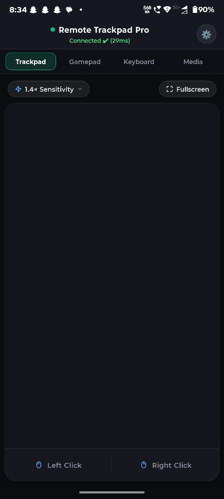<br/>
      <sub>Floating <b>1.4× Sensitivity ▾</b> pill, live ping badge, edge-to-edge glass surface, and seamless bottom Left/Right click zones.</sub>
    </td>
    <td align="center">
      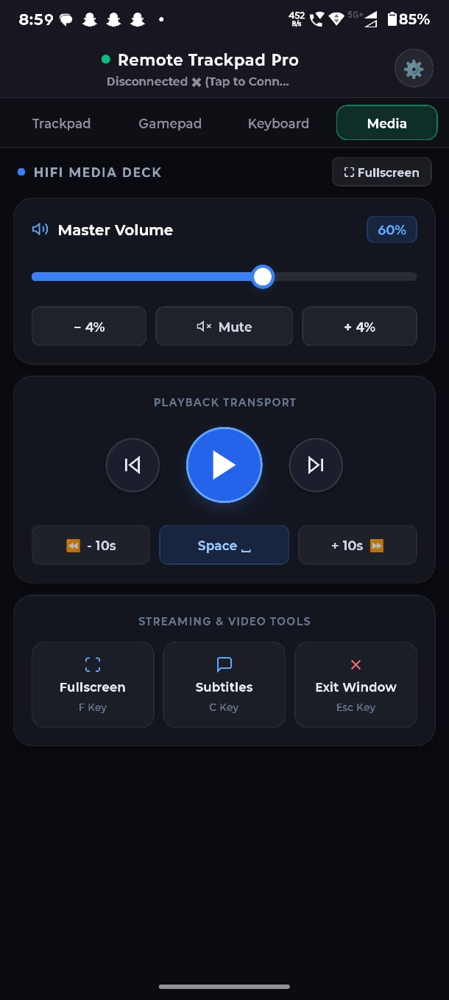<br/>
      <sub>Interactive Master Volume scrubber (0%–100%), circular glowing Play/Pause transport pod, ±10s seek, and streaming video controls.</sub>
    </td>
  </tr>
</table>

### ⌨️ Stretched Mechanical Keyboard (Portrait & Landscape)

<table>
  <tr>
    <th align="center" width="50%">⌨️ Portrait Mechanical Keyboard</th>
    <th align="center" width="50%">🖥️ Fullscreen Landscape Keyboard</th>
  </tr>
  <tr>
    <td align="center">
      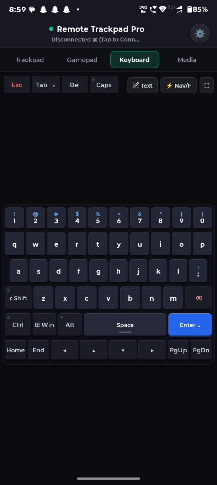<br/>
      <sub>3.5px drop bevel keycaps with physical travel depth, LED status lights (Caps/Ctrl/Alt), top utility bar, and dedicated navigation cluster.</sub>
    </td>
    <td align="center">
      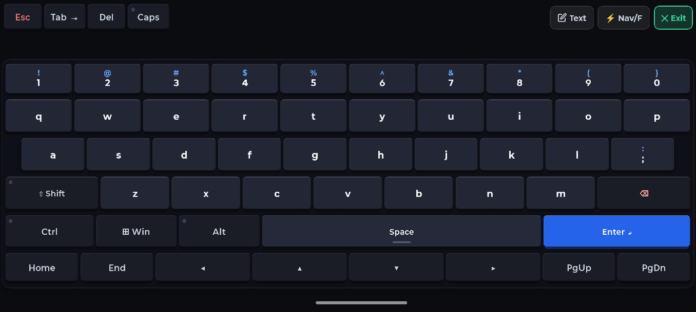<br/>
      <sub>100% stretched edge-to-edge landscape mode for two-thumb desktop typing, shortcuts, and PC command control.</sub>
    </td>
  </tr>
</table>

### 🎮 Pro Console Gamepad (3 Layouts & Tuning Drawer)

<table>
  <tr>
    <th align="center" width="50%">🎮 Arc Mobile Handheld Layout</th>
    <th align="center" width="50%">🎮 Xbox Layout (Asymmetric)</th>
  </tr>
  <tr>
    <td align="center">
      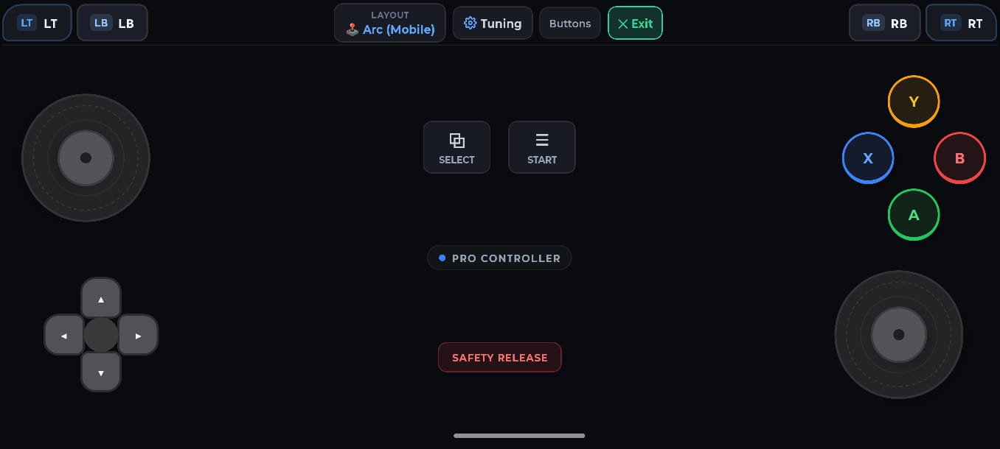<br/>
      <sub>Natural curved thumb sweep for mobile grip, jewel ABXY diamond, and top-corner wrap triggers.</sub>
    </td>
    <td align="center">
      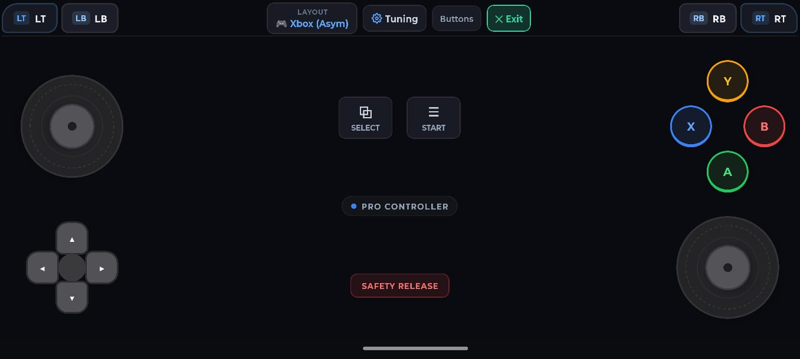<br/>
      <sub>Upper-left Left Stick for primary movement, lower-left D-Pad, right-side aim stick, and Select/Start buttons.</sub>
    </td>
  </tr>
  <tr>
    <th align="center" width="50%">🎮 PlayStation Layout (Symmetric)</th>
    <th align="center" width="50%">⚙️ Thumbstick Tuning Drawer</th>
  </tr>
  <tr>
    <td align="center">
      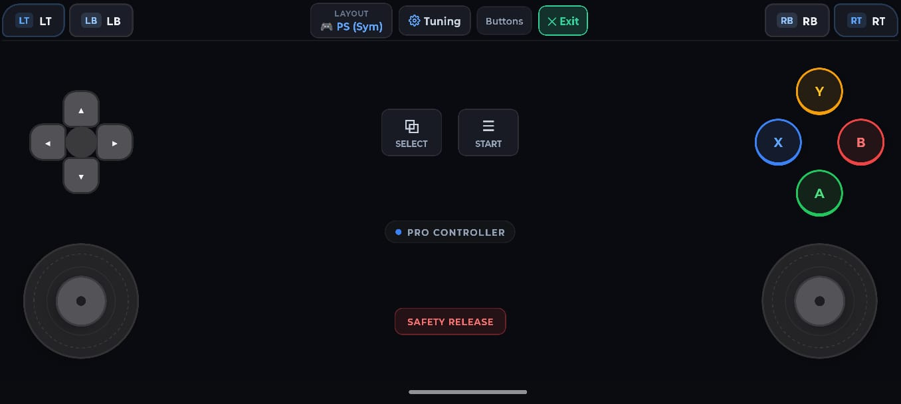<br/>
      <sub>Upper-left D-Pad, dual side-by-side lower thumbsticks, jewel ABXY action cluster, and safety release.</sub>
    </td>
    <td align="center">
      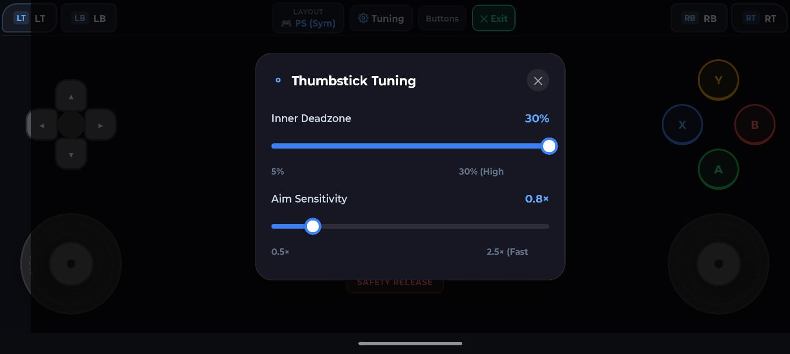<br/>
      <sub>Interactive tuning drawer with draggable Inner Deadzone (5%–30%) and Aim Sensitivity (0.5×–2.5×) sliders.</sub>
    </td>
  </tr>
</table>

### 📡 Wi-Fi Radar Connection & ⚙️ Settings Hub

<table>
  <tr>
    <th align="center" width="50%">📡 Host Connection & Wi-Fi Radar</th>
    <th align="center" width="50%">⚙️ Settings & Preferences Drawer</th>
  </tr>
  <tr>
    <td align="center">
      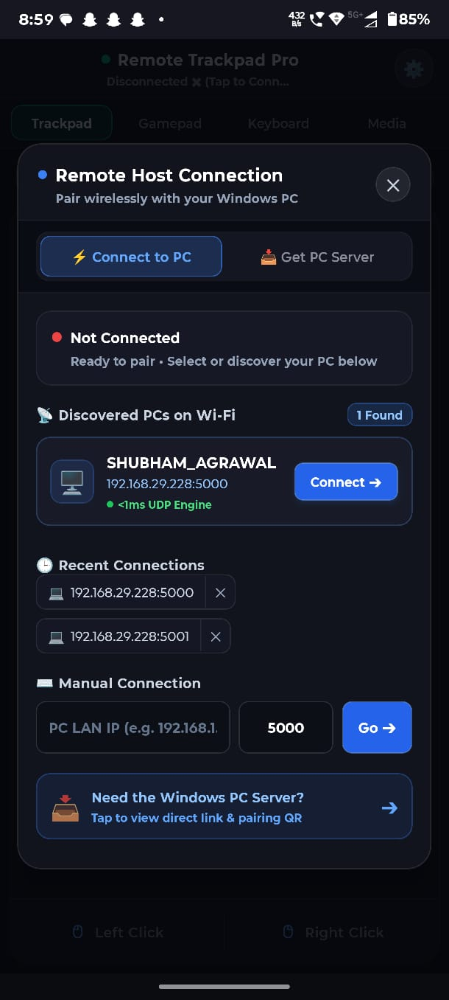<br/>
      <sub>Dual-wave Wi-Fi radar, discovered PC cards with <b>&lt;1ms UDP Engine</b> tags, 1-tap recent connection chips, and QR code pairing hub.</sub>
    </td>
    <td align="center">
      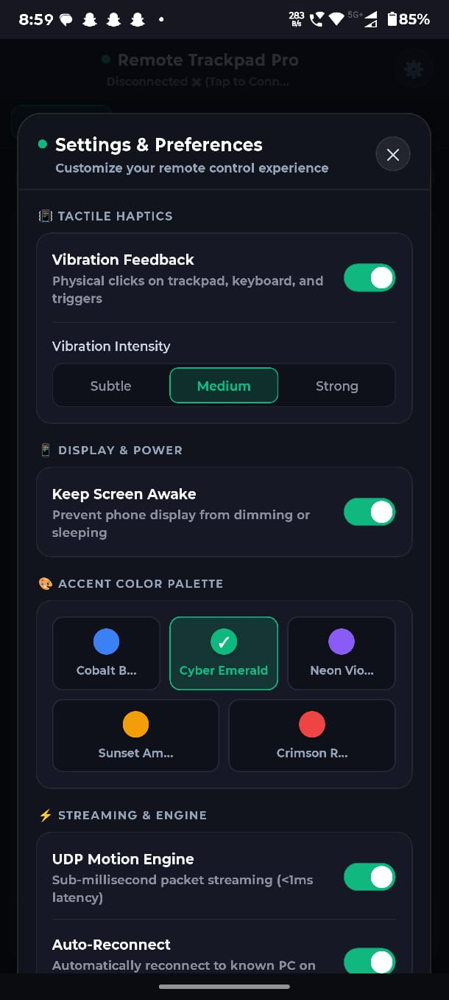<br/>
      <sub>Tactile haptics modulation (Subtle/Medium/Strong), Keep Screen Awake, 5 jewel accent color palettes, and streaming preferences.</sub>
    </td>
  </tr>
</table>

</div>

---

## 🚀 Quick Start

### Option A: Standalone 1-Click Binary (Zero Setup Required)

No Python, Node.js, or complex runtime dependencies required:

1. **Download PC Server for Windows**:
   - Grab **[RemoteMouseServer.exe](https://github.com/AgrShubham/Remote-trackpad-app/releases/download/v1.0.0/RemoteMouseServer.exe)** (`27.5 MB`).
   - Double-click to run. It launches quietly in your Windows System Tray and opens a clean status dashboard.
   - *(Optional)* Check **"Start Remote Mouse Server on Windows Boot"** for background readiness.

2. **Download Android App**:
   - Download **[app-release.apk](https://github.com/AgrShubham/Remote-trackpad-app/releases/download/v1.0.0/app-release.apk)** (`48.5 MB`) directly onto your phone.
   - Tap **Install** and open the app.

3. **Auto-Pair & Control**:
   - Connect your phone and PC to the same Wi-Fi network (or phone hotspot).
   - Your PC appears automatically in the app via the Wi-Fi radar scanner—tap **Connect** and enjoy zero-lag desktop control!

---

### Option B: Build from Source (For Developers)

#### 1. Clone the Repository
```bash
git clone https://github.com/AgrShubham/Remote-trackpad-app.git
cd Remote-trackpad-app
```

#### 2. Launch Host Server (Python)
```bash
cd server
pip install -r requirements.txt

# Run the interactive desktop tray server:
python server_app.py

# OR run the headless console worker:
python server.py
```

#### 3. Run Mobile App (React Native)
```bash
cd ../mobile
npm install

# Run on an attached Android device:
npm run android

# OR assemble a production release APK:
cd android && .\gradlew.bat assembleRelease
```

---

## 🧩 Core Modules

### 🖱️ 1. Precision Glass Trackpad
- **Sub-Pixel Motion Tracking**: Movement threshold configured at `0.1px` for microscopic cursor adjustments without deadband jitter.
- **Calmed Natural Ballistics**: Smooth velocity curve prevents cursor fling while retaining rapid desktop traversal:
  $$v_{\text{smooth}} = v_{\text{raw}} \times \left(1.0 + \min(2.5, v_{\text{raw}} \times 0.6)\right)$$
- **Floating Sensitivity Scrubber**: Tap `⚡ 1.4× Sensitivity ▾` to expand a real-time draggable scrubber modal with glowing thumb knob, live multiplier (`0.5×` to `3.5×`), and 4 instant presets:
  - `Slow (0.8×)` — Fine graphic design & pixel precision.
  - `Normal (1.4×)` — Default balanced desktop navigation.
  - `Fast (2.0×)` — Multi-monitor productivity.
  - `Turbo (2.8×)` — Ultrawide rapid traversal.
- **Kinetic Momentum Scrolling**: Natural two-finger glide with kinetic decay ($0.92\times$/frame) upon release.
- **Monolithic Bottom Clickpad**: Full-width Left and Right Click zones with zero touch focus artifacts.

---

### ⌨️ 2. Stretched 80% Mechanical Keyboard
- **Edge-to-Edge Key Geometry**: 100% stretched chassis with 46px thumb keycaps and 3.5px drop bevel depth.
- **3D Press Physics**: Physical `translateY: 2px` key travel on press with tactile haptic feedback.
- **Circular Hardware LED Indicators**: 3D green LED light dots that glow bright green when `Caps Lock`, latched `Ctrl`, or latched `Alt` are engaged.
- **Dedicated Arrow Cluster**: Separate bottom navigation strip featuring `◀`, `▲`, `▼`, `▶`, `Home`, `End`, `PgUp`, and `PgDn`.
- **Top Utility Ribbon**: Instant access to `Esc`, `Tab`, `Del`, `Caps`, `⚡ Nav/F` switcher, and expandable `📝 Quick Text` drawer for pasting long paragraphs.
- **Orientation Support**: Seamless edge-to-edge typing in both portrait and landscape modes.

---

### 🎮 3. Pro Console Gamepad
- **3-Way Layout Switcher**:
  - **Arc (Mobile Handheld)**: Ergonomic thumb arcs built specifically for handheld phone gaming.
  - **Xbox (Asymmetric)**: Top-left Left Stick for primary analog movement, bottom-left D-Pad, top-right ABXY diamond, bottom-right Look Stick.
  - **PlayStation (Symmetric)**: Top-left D-Pad, dual side-by-side bottom concentric sticks, top-right action buttons.
- **Top-Corner Wrap Triggers**: Curved `LT`/`LB` (top-left) and `RT`/`RB` (top-right) touch trigger pads wrapping the device corners for natural index-finger reach.
- **Jewel-Style ABXY Diamond**: 3D drop-beveled console buttons (`A`=Green, `B`=Red, `X`=Blue, `Y`=Yellow) with zero focus glitches.
- **Interactive Thumbstick Tuning**: Slide-in drawer with live draggable sliders:
  - **Inner Deadzone** (`5%` to `30%`): Filter out thumb drift.
  - **Aim Sensitivity** (`0.5×` to `2.5×`): Fine-tune crosshair look and camera rotation.

---

### 🎵 4. Modern Hifi Media Deck
- **Touch Volume Scrubber**: Full-width draggable volume slider with live percentage badge (`0%–100%`) and glowing blue track.
- **Step & Mute Controls**: `− 4%` and `+ 4%` fine-tuning buttons and glowing red/amber Mute toggle.
- **Playback Transport Pod**: Large 70px circular Play/Pause button with cobalt aura (`#3b82f6`), flanked by circular 50px `⏮ Previous Track` and `⏭ Next Track` buttons.
- **Video Scrubbing**: Dedicated `⏪ -10s` and `+10s ⏩` buttons for YouTube, Netflix, VLC, and browser video players.
- **Streaming Video Suite**: 1-tap `Fullscreen (F)`, `Subtitles (C)`, and `Exit Window (Esc)` buttons.

---

### 📡 5. Wi-Fi Radar Discovery & Pairing QR Hub
- **Animated Dual-Wave Radar**: Concentric pulse rings expanding and fading continuously during network discovery.
- **Discovered PC Cards**: Clean glass cards displaying hostname, IP:Port, `<1ms UDP Engine` tag, and vibrant `Connect ➔` button.
- **Recent Connection Chips**: 1-tap horizontal chip row for instant reconnect to recent computers.
- **PC Server Download Hub**: High-contrast white QR code frame for scanning from PC webcams or mobile browsers, plus 1-tap "Open in Browser" and "Share Link" actions.

---

### ⚙️ 6. Settings & Preferences Drawer
- **Haptic Intensity Modulation**: Choose between `Subtle` (12–18ms), `Medium` (20–30ms), and `Strong` (35–50ms) with immediate demo vibration on tap.
- **Display Keep-Awake**: Prevents phone display from sleeping during trackpad or gaming sessions.
- **Accent Theme Palettes**: 5 jewel color swatches (**Cobalt Blue**, **Cyber Emerald**, **Neon Violet**, **Sunset Amber**, **Crimson Red**).
- **UDP Engine & Auto-Reconnect**: Toggle low-latency packet streaming and automatic startup connection.

---

## ⚡ Dual-Channel Network Architecture

The system uses a **hybrid networking model** to achieve low latency without compromising input reliability:

```mermaid
sequenceDiagram
    autonumber
    participant Phone as 📱 Android Device
    participant LAN as 📶 Local Wi-Fi / Hotspot
    participant Server as 💻 Windows Host Server (Ports 5000, 5001, 5002)
    participant Kernel as 🪟 Windows Kernel (user32.dll)

    Note over Server: Server broadcasts UDP beacon on Port 5001
    Server->>LAN: UDP Beacon: {"app": "RemoteTrackpadPro", "ip": "192.168.1.5", "port": 5000, "udp_port": 5002}
    Phone->>LAN: DiscoveryService listens on UDP 5001
    LAN-->>Phone: Beacon received -> Host card rendered with <1ms tag

    Phone->>Server: WebSocket Handshake (Port 5000 TCP)
    Server-->>Phone: Connected ACK + Ping monitor starts

    rect rgb(15, 23, 42)
        Note over Phone, Kernel: High-Speed UDP Motion Pipeline (<1ms, Zero Head-of-Line Blocking)
        Phone->>Server: UDP Datagram: "M <dx> <dy>" directly to Port 5002
        Server->>Kernel: SendInput(INPUT_MOUSE, dx, dy) [Instant Kernel Injection]
    end

    rect rgb(20, 30, 25)
        Note over Phone, Kernel: Reliable TCP WebSocket Pipeline (Keys, Clicks, Volume, Media)
        Phone->>Server: socket.emit("key", {"name": "w", "action": "press"})
        Server->>Kernel: pynput.keyboard.press("w")
    end
```

### Network Ports Reference

| Port | Protocol | Purpose |
| :---: | :---: | :--- |
| **5000** | TCP (WebSocket / HTTP) | Stateful keyboard keystrokes, mouse clicks, media commands, and Web Trackpad fallback |
| **5001** | UDP (Broadcast) | Automatic Wi-Fi network host discovery beacon |
| **5002** | UDP (Unicast Datagram) | High-speed mouse motion & thumbstick packet streaming (<1ms latency) |
| **8080** | HTTP (Static Server) | Local network APK & Windows binary distribution server |

---

## ⚖️ Feature Matrix

| Capability | Remote Trackpad Pro | Unified Remote | KDE Connect | WiFi Mouse |
| :--- | :---: | :---: | :---: | :---: |
| **100% Free & Open Source** | ✅ **Yes (MIT)** | ❌ Paid / Freemium | ✅ Yes | ❌ Ads & In-App Purchases |
| **Sub-Millisecond UDP Motion Engine** | ✅ **Yes (<1ms)** | ❌ TCP Only | ❌ TCP Only | ❌ High Jitter |
| **Zero-Setup Standalone `.exe`** | ✅ **Yes (Tray App)** | ❌ Heavy Installer | ❌ Complex Daemon | ❌ Heavy Installer |
| **Animated Wi-Fi Radar Auto-Pairing** | ✅ **Yes (1-Tap)** | ⚠️ Unreliable | ⚠️ Manual Pairing | ⚠️ Manual IP Required |
| **3 Gamepad Layouts (Arc/Xbox/PS)** | ✅ **All 3 Included** | ❌ Basic | ❌ None | ❌ None |
| **Live Thumbstick Deadzone & Aim Tuning**| ✅ **Included** | ❌ None | ❌ None | ❌ None |
| **3D Beveled Mechanical Keyboard** | ✅ **LED Indicators & Travel** | ❌ Flat Text | ❌ Basic Input | ❌ Flat Text |
| **Touch Volume Scrubber & ±10s Seek** | ✅ **Full Suite** | ⚠️ Basic Volume | ⚠️ Basic Controls | ⚠️ Basic Volume |
| **Custom Haptic Intensity Modulation** | ✅ **Subtle/Medium/Strong** | ❌ None | ❌ None | ❌ None |
| **Screen Keep-Awake Toggle** | ✅ **Built-in** | ❌ No | ❌ No | ❌ No |
| **Zero Cloud Telemetry & 100% Offline** | ✅ **Private LAN Only** | ❌ Cloud Accounts | ✅ Local | ❌ Ad Trackers |

---

## 🔒 Privacy & Security

- **100% Local Network Operation**: All packets stay strictly within your private Wi-Fi network or mobile hotspot.
- **Zero Cloud Traffic**: No user accounts, cloud telemetry, tracking analytics, or external API pings.
- **Driverless Architecture**: Injects standard Windows user-space input events via Win32 `SendInput` APIs without installing unsigned kernel drivers.
- Complete policy details: [PRIVACY_POLICY.md](PRIVACY_POLICY.md).

---

## 🤝 Contributing

Contributions are warmly welcomed! Whether you want to improve trackpad physics, add new gamepad controller profiles, optimize network protocols, or refine the UI:

1. **Fork the Repository**: `https://github.com/AgrShubham/Remote-trackpad-app`
2. **Create a Feature Branch**:
   ```bash
   git checkout -b feature/NewFeature
   ```
3. **Commit Your Changes**:
   ```bash
   git commit -m "feat: add NewFeature"
   ```
4. **Push to Your Branch**:
   ```bash
   git push origin feature/NewFeature
   ```
5. **Open a Pull Request**!

---

## 📄 License

This project is licensed under the **MIT License** — see the [LICENSE](LICENSE) file for details.

---

<div align="center">
  <sub>Built with ❤️ by <a href="https://github.com/AgrShubham">Shubham Agrawal</a>. If you find this project helpful, please consider starring ⭐ the repository!</sub>
</div>
