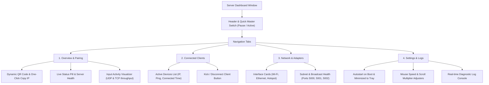

# Remote Mouse Server: Architecture & UX/UI Improvement Plan

## 1. Executive Summary & Objectives
The Windows host server (`server_app.py` & `server.py`) is the core engine of **Remote Mouse & Gamepad Pro**. Currently, while the background Gevent and UDP engine perform reliably, the desktop application's user interface and user experience are rudimentary:
- It lacks real-time awareness of connected mobile devices.
- It provides no input telemetry or live packet throughput stats.
- It displays only a single hardcoded IP address, causing confusion on multi-adapter setups (e.g. Wi-Fi + Ethernet + Windows Mobile Hotspot).
- It lacks security controls (no pairing PIN or instant input pause/kill-switch).
- The Tkinter dashboard looks like a dated legacy dialog rather than a sleek, modern desktop utility.

This plan details a modern overhaul of the server application to deliver an **intuitive, elegant, and production-grade Windows host experience**.

---

## 2. Key Deficiencies & Planned Solutions

| Area | Current Limitation | Planned Improvement |
|---|---|---|
| **Live Device Telemetry** | Server has zero visibility into connected phones/tablets. | **Real-Time Client Deck**: Lists active client devices with IP, latency (ping), connected duration, and 1-tap disconnect. |
| **Input Activity Monitor** | PC user cannot tell if inputs are arriving or dropping. | **Live Packet & Activity Gauge**: Visual pulses/meters for UDP motion packets, clicks, keyboard events, and gamepad sync. |
| **Multi-Adapter Network Hub** | Dashboard shows only 1 IP; fails when using Hotspot or dual NICs. | **Dynamic Adapter Selector**: Tabs/pills for all active network interfaces (Wi-Fi, Mobile Hotspot `192.168.137.x`, Ethernet) with dynamic QR code generation. |
| **Safety & Access Control** | Anyone on LAN can connect without authorization. | **Security Master Switch & Optional PIN**: "Pause Remote Inputs" kill-switch + optional one-click pairing authorization. |
| **Modern UI & Aesthetic** | Basic, flat Tkinter layout with standard widgets. | **Obsidian Glass Fluent UI**: Custom-styled widgets, rounded cards, sleek telemetry badges, status glows, and dark modern typography. |
| **System Tray & Alerts** | Tray menu is static; no notifications on connect. | **Enhanced Tray & Windows Notifications**: Real-time connected count in tooltip, Windows toast alert on device connect, and quick pause toggle. |
| **Diagnostics & Logging** | No visible server logs or error diagnosis for users. | **Embedded Live Console**: Filterable diagnostic log drawer with auto-scroll and 1-click log export. |

---

## 3. UI/UX Architecture & Layout Design

The redesigned Server Control Dashboard will be organized into 4 cohesive tabs / sections:

### 3.1 Tab 1: Overview & Instant Pairing
- **Hero Status Card**: Glowing server state indicator (`🟢 Active & Broadcasting` / `🟡 Inputs Paused`).
- **Interactive QR Code**: Rendered with high contrast, clicking the QR copies the connection URL to clipboard with a toast notification.
- **Master Kill-Switch ("Pause Remote Inputs")**: Lets the user immediately freeze all remote mouse/keyboard inputs with one click or a global shortcut if someone else is on their PC.
- **Throughput Gauge**: Live counters showing `Packets/sec`, `Motion Events`, and `Average Latency`.

### 3.2 Tab 2: Connected Clients & Security
- Real-time list of all connected Socket.IO & UDP clients.
- For each device:
  - Device IP & Host Name
  - Connection Duration (`Connected 12m 45s ago`)
  - Last Ping Latency (`3ms`)
  - Active Mode (`Touchpad`, `Gamepad`, `Media`)
  - Action button: `Disconnect / Block`

### 3.3 Tab 3: Network & Multi-Adapter Hub
- Detects all available network interfaces dynamically using `get_all_lan_ips()`:
  - Primary Wi-Fi (`192.168.1.x`)
  - Windows Mobile Hotspot (`192.168.137.1`)
  - Ethernet / Virtual LANs
- Switching the active adapter automatically re-generates the QR code and updates the pairing URL.
- Live port status check: Verifies TCP 5000, UDP 5001 (Beacon), and UDP 5002 (Motion) are binding without firewall or port-collision errors.

### 3.4 Tab 4: Preferences & Diagnostic Logs
- **Server Preferences**:
  - Start on Windows Boot (checkbox with registry integration).
  - Start minimized to System Tray.
  - Server-side cursor speed dampening / multiplier (0.5× to 2.0×).
  - Toast notification toggle on client connect.
- **Embedded Console Drawer**:
  - Live streaming log output from background worker.
  - Color-coded log lines: `[INFO]`, `[CONNECT]`, `[UDP]`, `[WARN]`.
  - Buttons: `Clear Logs`, `Copy to Clipboard`.

---

## 4. Technical Implementation Steps

### Phase 1: Server Worker IPC & State Bridge (`server.py` & `server_app.py`)
1. Implement bidirectional IPC between `server_app.py` (GUI) and `server.py` (Worker):
   - Expose real-time client tracking (`connected_clients: dict` tracking `sid`, `ip`, `connected_at`, `last_ping`, `input_count`).
   - Emit state change events (`client_connect`, `client_disconnect`, `packet_stat`).
   - Add master pause state (`inputs_paused = True/False`) in `server.py` that suppresses cursor and keystroke dispatch when paused.

### Phase 2: Enhanced Modernized Dashboard GUI (`server_app.py`)
2. Overhaul `ControlDashboard`:
   - Implement custom modern dark styling with high-contrast text and clean borders.
   - Build tabbed navigation (`Overview`, `Clients`, `Network`, `Settings & Logs`).
   - Build the live QR generator with adapter switcher dropdown/pills.
   - Build client management table with real-time refresh (polling every 1s or queue-driven).
   - Build real-time diagnostic console widget with auto-scroll.

### Phase 3: System Tray & Windows Notifications Enhancements
3. Update `setup_system_tray()`:
   - Dynamic tray menu showing live connected client count.
   - One-click "Pause Remote Inputs" menu item.
   - Windows toast notifications when a new phone connects or disconnects.

### Phase 4: Verification & Binary Release Packaging
4. Verify end-to-end:
   - Test multi-adapter switching (Wi-Fi vs Mobile Hotspot).
   - Test "Pause Inputs" safety kill-switch.
   - Test client connection/disconnection telemetry.
   - Recompile `RemoteMouseServer.exe` with PyInstaller.
   - Document changes in `CHANGELOG.md`.

---

## 5. Security & Performance Considerations
- **Zero Overhead**: Telemetry uses lightweight counters and queues so the ultra-low latency UDP pipeline (<1ms) remains unaffected.
- **Graceful Port Collision Handling**: If port 5000 is occupied, auto-cleans stale processes or alerts the user cleanly.
- **Thread Safety**: UI updates are dispatched safely onto Tkinter's main loop via thread-safe queues or `root.after()`.

